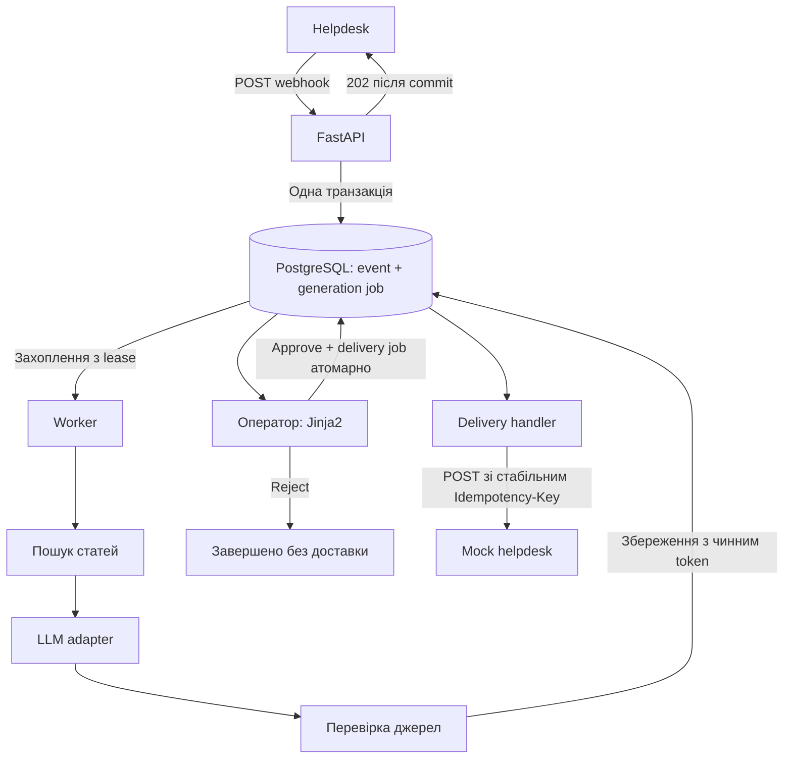

# Як працює рішення і як пояснити його на співбесіді

Це компактний сервіс для конкретного workflow. Його складність зосереджена в
надійному прийманні, конкурентності та доставці: саме ці вимоги роблять задачу
складнішою за звичайний CRUD. LLM готує пропозицію; остаточне рішення приймає людина.

## Шлях одного звернення



1. `webhooks.py` перевіряє JSON та дозволену адресу доставки. Подія і завдання
   генерації зберігаються разом. `202` означає «надійно прийняли», а не «відповіли клієнту».
2. `queue.py` у короткій транзакції перевіряє глобальний ліміт, захоплює завдання
   й призначає token та lease. Транзакція завершується до LLM-запиту.
3. `generation.py` отримує релевантні статті, викликає `DraftGenerator`, перевіряє
   джерела й додає URL, побудовані сервером. Worker записує результат у `jobs.result`.
4. `operator.py` показує чернетку. Approve атомарно записує рішення та створює
   delivery job із копією затвердженого тексту; reject не створює доставки.
5. `delivery.py` перевіряє дозвіл і lease, закриває сесію БД та надсилає повідомлення.
   Лише `201` означає успіх. Мок зберігає прийняту відповідь у `mock_receipts`.

## За що відповідають файли

| Файл | Відповідальність |
|---|---|
| `config.py`, `db.py` | Налаштування, секрети, з'єднання й сесії PostgreSQL |
| `models.py`, `migrations/` | Структура даних, унікальні обмеження та версії схеми |
| `webhooks.py` | Валідація, дедуплікація, атомарне приймання |
| `queue.py` | Claim, глобальний ліміт, leases, fencing, backoff |
| `worker.py` | Цикл виконання та складання конкретних адаптерів |
| `knowledge.py` | Дев'ять статей LumaDesk і простий пошук |
| `llm.py`, `generation.py` | Контракт і адаптер LLM, збирання та перевірка чернетки |
| `operator.py`, `templates/operator.html` | Авторизація, UI, approve/reject |
| `delivery.py`, `reply_urls.py` | Контракт доставки, HTTP-адаптер, дозволені адреси |
| `mock_helpdesk.py` | Надійна дедуплікація отриманих повідомлень і симуляція збоїв |
| `main.py` | Фабрика API, lifecycle, маршрути статей та `/health` |
| `tests/`, `.github/workflows/ci.yml` | Автоматична перевірка поведінки та регресій |

## Чому саме такі рішення

| Рішення | Аргумент | Компроміс |
|---|---|---|
| FastAPI та async HTTPX/SQLAlchemy | Багато очікування мережі; явна валідація й простий API | Async сам по собі не дає надійності; потрібні транзакції |
| Черга в PostgreSQL | Подія і job комітяться разом; PostgreSQL уже обов'язковий | Власна невелика логіка polling/retry; для значно більшого масштабу переоцінити брокер |
| Окремий worker | LLM триває 5–30 с, а webhook має відповісти до 2 с | Два процеси зі спільним кодом |
| DB uniqueness | Остаточно розв'язує гонку одночасних дублікатів | Потрібні справжні PostgreSQL-тести |
| Lease + fencing token | Відновлення після збою без запису застарілого результату | Оренда не скасовує вже відправлений зовнішній HTTP-запит |
| Один рядок політики LLM | Усі процеси й повтори бачать один бюджет | Коротка серіалізована ділянка; достатньо для заданого навантаження |
| Пошук за словами | Для дев'яти статей прозорий і перевірюваний | Не розуміє всі синоніми; можна підмінити функцію пошуку |
| Jinja2 і HTTP Basic | Достатньо для одного оператора і базового UI | Перед публічним запуском потрібні власний пароль і HTTPS |

Механізм запису події разом із durable job використовує ідею transactional outbox.
Ми не пишемо спочатку в БД, а потім у незалежну чергу: збій між такими діями міг би
залишити подію без роботи. Тут обидва записи або існують, або відкочуються разом.

## Open/Closed і передавання залежностей

`DraftGenerator` та `HelpdeskSender` — невеликі `Protocol`: описують необхідну поведінку.
Обробники залежать від цих контрактів. `worker.main()` є місцем складання: саме там
обираються `OpenAIAdapter` та `HTTPHelpdeskAdapter`.

Щоб додати іншого LLM-провайдера, реалізуйте async-метод
`generate(message, articles) -> Candidate` і передайте цей об'єкт у `GenerationHandler`.
Йому не потрібно успадковувати клас: Python Protocol використовує структурну типізацію.
Аналогічно нова інтеграція helpdesk реалізує `send(url, ticket_id, message, key)`.
Заміна пошуку — передавання функції `search(message) -> list[Article]` через аргумент `search=`.

Наприклад, місце складання може виглядати так (імена нового адаптера й пошуку умовні):

```python
generation = GenerationHandler(
    sessions,
    AnotherProviderAdapter(...),
    str(settings.public_base_url),
    search=postgres_search,
)
```

Змінюється складання залежностей і додається нова реалізація. Черга, модерація й
контракт результату залишаються придатними. Тест `test_workflow.py` уже підставляє
інший генератор та пошук і проходить повний сценарій.

Контракт має включати поведінку: один зовнішній LLM-запит на допуск, без прихованих
retry; тимчасові помилки — `RetryableError`, постійні — `PermanentError`; джерела
належать переданим статтям. Новий helpdesk мусить підтримувати надійний ключ
ідемпотентності для поточної гарантії відсутності дублів.

Тут немає універсальних Repository, DI-контейнера чи фабрики на кожен клас:
SQLAlchemy вже вирішує доступ до БД, а конкретних реалізацій небагато.
Middleware доречне для наскрізних HTTP-потреб — наприклад, request ID або tracing.
Воно не є умовою SOLID і не потрібне для заміни LLM. Авторизацію локальних маршрутів
виражено через FastAPI dependencies, доменну поведінку — через обробники.

## Питання, які можуть поставити

**Чому не `BackgroundTasks`?** Завдання лише в пам'яті процесу можна втратити при
перезапуску. Тут воно записане до `202`, тому інший worker зможе продовжити роботу.

**Чому не `SELECT`, а потім `INSERT`?** Два запити можуть одночасно не знайти подію.
Унікальний ключ і `ON CONFLICT` вирішують гонку в самій БД.

**Навіщо lease і token одночасно?** Lease дозволяє забрати завислу роботу після 60 с.
Новий token відрізняє нового власника від старого. Запис результату перевіряє і token,
і строк оренди; старий worker не перезапише новий результат.

**Чому не тримати блокування весь час?** Повільний HTTP-виклик утримував би сесію,
connection і lock на секунди. Короткі транзакції дозволяють іншим запитам працювати.

**Чим rate limit відрізняється від concurrency?** Перше — максимум 60 допусків за
ковзні 60 секунд, друге — максимум активних generation leases (типово 32).
`WORKER_PARALLELISM` окремо визначає кількість локальних виконавців.

**Що буде після падіння worker?** Завдання залишиться running до закінчення lease,
потім його захоплять із новим token. Кількість спроб обмежена трьома;
після вичерпання воно залишається видимим як failed, а не зникає.

**Що, якщо helpdesk прийняв повідомлення, але ми отримали timeout?** Повторимо той самий
job із тим самим `delivery:<UUID>`. Мок поверне успіх без нового повідомлення.
Без підтримки цього ключа віддаленою системою exactly-once обіцяти не можна.
Failed після таймаутів теж не доводить, що повідомлення не було прийнято.

**Як захищаємося від галюцинацій?** Передаємо знайдені статті, перевіряємо ID та
будуємо URL на сервері. Це підтверджує існування джерел, але не істинність кожної
фрази. Семантичну якість перевіряє оператор; невідоме питання позначаємо для уточнення.

**Що доводять тести?** Конкурентні обмеження, rollback, відновлення, retries, весь
workflow та обсяг 500 звернень перевірені на PostgreSQL. Адаптери перевірені
контрольованим HTTP. Coverage показує виконані ділянки й гілки, не доводить відсутність
усіх можливих дефектів. Платний реальний LLM із ключем власника не викликався.

**Що додати для production?** Після уточнення вимог: авторизацію webhook від конкретного
helpdesk, HTTPS і керування секретами, моніторинг backlog/failed jobs, резервування БД,
політику зберігання персональних даних. Ручний повтор failed delivery треба проєктувати
зі збереженням того самого idempotency key та звіркою з helpdesk.

## Коротка усна відповідь

«Я відокремив швидке приймання звернень від повільної генерації. Подію й фонове завдання
зберігаю однією транзакцією PostgreSQL, а дублікати зупиняє унікальний event_id.
Worker працює з короткими орендами, token захищає від застарілого результату.
Усі процеси ділять ліміт LLM через БД. Оператор підтверджує текст до надсилання,
а delivery використовує стабільний ключ ідемпотентності. Інтеграції підміняються
через невеликі контракти; надійність перевірена конкурентними й наскрізними тестами».
